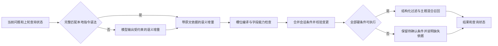

# 人才检索语义编译与会话状态设计

## 问题与处理原则

检索历史暴露的是三个边界问题：模型可以选择错误的物理列，追问可能错误修改旧条件，数据缺失可能被当成“没有人才”。增加提示词或逐句补规则无法保证这三个边界。

本次改为以下执行链：

大模型负责解释用户表达，程序负责约束执行语义。普通检索仍使用既有字段筛选、BM25、向量召回、RRF 和分页，不增加新的 Agent 框架、数据库或逐人模型调用。

## 语义槽位和物理字段

`talent_semantics.py` 是单一编译边界。模型输出 `facets`，不自行选择物理列：

| 槽位 | 含义 | 编译依据 |
|---|---|---|
| `topic` | 研究主题 | 领域、研究方向、细分关键词等业务字段 |
| `current_region` | 人才当前国家或地域 | 所在国家／城市的明确首段 |
| `current_location` | 当前具体地点 | 所在国家／城市 |
| `current_institution` | 当前机构实体 | 当前机构 |
| `institution_country` | 机构本身国别 | 明确的机构国别字段；缺失则待确认 |
| `institution_type` | 大学、企业、医院、研究机构 | 明确类型字段优先，其次机构名称中的明确类型词 |
| `education` | 教育经历 | 教育经历 |
| `employment_history` | 历史任职 | 工作经历 |
| `employment_experience` | 包括现任的任职经历 | 当前机构和工作经历 |
| `any_affiliation` | 任意机构关联 | 当前机构、工作经历、教育经历 |
| `position` | 当前职务 | 当前职务 |
| `metric` | 明确数值条件 | 现有允许的指标字段，数值操作经校验 |
| `unresolved` | 无法可靠执行的要求 | 保留要求并说明 |

每个新条件包含当前问题中的原文 `evidence`。国家值经过别名归一和原文核验；国家不能编译成机构实体，机构类型需要明确类型依据，数值条件不能任意绑定文本列。未知协议字段、未知槽位和无效数据会被拒绝。

例：“英国院校”输出两个不同条件：机构国别为英国、机构类型为大学。既不执行“当前机构包含英国”，也不默认改成人才所在地为英国。

目前在线表没有明确的机构国别字段。因此只能保留这个要求并说明限制。大学类型可由名称中的 University、College、大学等明确词识别；MIT 等只有缩写的名称仍视为未知。该策略优先避免误报，会漏掉无法识别类型的缩写，不能宣称机构分类完整。

## 会话状态与变更

接口继续沿用 `query_state.plan`。新增槽位和依据是可选字段；旧计划仍可读取，并在执行前重新绑定和校验。旧历史中将国家误填为机构名的计划会转为待确认，不修改历史会话文本或原始人才资料。

- `mode=add` 添加条件，未提及的领域、机构、排序和数量限制继承。
- `mode=set` 只替换相同槽位的已有条件。追问“美国院校的呢”替换机构国别，保留 AI4S 和院校类型。
- 同槽位国家切换有可独立校验的原文依据时，不再额外调用模型复核。删除其他条件、重置等仍走既有变更复核。
- 用户明确说“按所在地筛选”时，才允许把待确认的机构国别改为人才当前所在地。转换沿用待确认国家，清理旧所在地条件，保留主题和院校类型。
- 待确认状态也返回查询状态，后续追问可以继续完成查询。

本地语法必须完整消费问题。包含额外否定、复杂关系或未识别约束的句子交给模型，不截取一部分便执行。国家词表服务于通用地理归一，不针对某个人名或 AI4S 数据打补丁。

## 结果、性能和可观测性

硬条件不可执行时，不返回已满足全部条件的人才名单，也不把它渲染为“零匹配”。提示会区分“尚无法完整筛选”和“已执行但没有召回”。此时跳过主题向量调用和重排，避免对无法执行的查询继续消耗时间。

模型请求仅提供槽位能力、可排序指标和精简上轮状态；输出为本轮增量。减少字段描述和重复计划的输入输出量。可确定的国家追问、排序等使用本地执行路径，复杂查询保留模型规划。

执行轨迹新增“语义槽位编译”，记录槽位、编译字段、值及是否待确认；既有模型调用和检索轨迹继续保留。原始数据与向量索引未改变，本次无需重新生成向量，也不改动共享模型服务。

## 验证记录

后端单元与接口回归：215 项，成功，1 项按既有条件跳过。新增测试覆盖所有已配置中英文国家别名、错误字段绑定、缺失国别、未知机构类型、原文证据、历史任职、多轮切换、旧计划兼容、待确认状态序列化、无关条件删除保护，以及真实接口对模型 `facets` 协议的接入。

线上真实数据验证使用独立回归会话，未改动人才数据或已有会话：

| 连续问题 | 观察结果 | HTTP 耗时 |
|---|---|---:|
| 查找海外，从事AI4S领域的人才 | 正常召回；首次新协议规划 | 2.836 秒 |
| 同一问题，缓存命中 | 正常召回 | 0.318 秒 |
| 英国院校的人才有么 | 保留 AI4S，明确缺少机构国别 | 0.196 秒 |
| 美国院校的呢 | 只切换机构国别，仍待确认 | 0.191 秒 |
| 按所在地筛选 | 美国所在地、院校类型和 AI4S 正常执行 | 0.316 秒 |
| 英国人才 | 英国所在地、院校类型和 AI4S，返回 2 条 | 0.188 秒 |

上述连续缓存回归的执行轨迹均为成功，无模型调用。首次请求与后续缓存请求分开统计。这是少量功能与延迟样本，不能当成并发压测或 P95，也不代表任意复杂语义请求必定小于 5 秒。

最终部署版本为 `20261117T020325Z-62437`，容器健康检查通过。该版本重启后再次执行同一组五轮请求全部成功：首次 2.648 秒，四次追问分别为 0.289、0.176、0.200、0.169 秒。显式切换所在地后，计划中只保留新的国家地域条件，最终英国所在地结果仍为 2 条。

## 后续数据改进

优先补充机构标准实体、机构类型和机构国别，并为每个值记录来源、更新时间及未知状态，再让现有编译器绑定这些明确字段。机构跨国分校和联合任职需明确按哪一个实体统计。不能让模型仅凭名称或人才所在地补写国别。

在数据依据完整以后，再扩展经过评估的同义主题和复杂关系能力。回归应围绕“表达等价、条件变化、数据缺失、混合语言、耗时”形成样本集，分别记录准确率、未知比例、误报和冷/热请求耗时；避免仅以返回名单或提示语是否自然作为成功标准。
